# Sistema de Inventario de Videojuegos

Aplicación de consola en Python para administrar un inventario de videojuegos. Permite registrar, consultar, actualizar, eliminar y vender productos, guardando la información en una base de datos SQLite. Está construida con programación orientada a objetos (POO) y el patrón **DAO** (*Data Access Object*), separando claramente la interfaz, las reglas de negocio y el acceso a datos.

## Propósito del sistema

Ofrecer un menú interactivo para gestionar el stock de una tienda de videojuegos (operaciones CRUD y ventas), con validaciones que impiden datos inválidos y que conserva la información entre ejecuciones en el archivo `tienda.db`.

## Estructura del proyecto

```text
.
├── main.py               # Menú interactivo (entrada/salida por consola)
├── producto_servicio.py  # Validaciones y reglas de negocio
├── producto_dao.py       # Operaciones SQL (CRUD)
├── base_datos.py         # Conexión a SQLite y creación de la tabla
├── modelo.py             # Clase Producto
├── .gitignore
└── README.md
```

| Archivo | Responsabilidad |
|---|---|
| `modelo.py` | Define la clase `Producto` (`id`, `nombre`, `precio`, `stock`). |
| `base_datos.py` | Abre la conexión con `tienda.db` y crea la tabla `productos` si no existe. |
| `producto_dao.py` | `ProductoDAO`: único lugar donde hay consultas SQL (crear, listar, buscar por ID, actualizar, eliminar). |
| `producto_servicio.py` | `ProductoServicio`: valida los datos y aplica las reglas (por ejemplo, no vender más del stock). Usa el DAO. |
| `main.py` | Muestra el menú, pide los datos al usuario y llama a los métodos del servicio. Incluye las funciones auxiliares `limpiar()`, `pausar()` y `pedir_entero()`. **No contiene SQL.** |

Flujo de una operación: `main.py` → `ProductoServicio` (valida) → `ProductoDAO` (SQL) → SQLite.

## Funcionalidades implementadas

| # | Opción del menú | Descripción |
|---|---|---|
| 1 | Registrar videojuego | Solicita nombre, precio y stock, y lo guarda con un ID autogenerado. |
| 2 | Mostrar inventario | Lista todos los videojuegos con ID, nombre, precio y stock. |
| 3 | Buscar videojuego | Consulta un producto por ID e informa si no existe. |
| 4 | Actualizar videojuego | Modifica nombre, precio y stock de un producto existente. |
| 5 | Eliminar videojuego | Elimina un producto por ID. |
| 6 | Vender unidades | Descuenta unidades del stock; rechaza la venta si supera el stock disponible. |
| 7 | Salir | Finaliza la aplicación correctamente. |

Los datos **se conservan entre ejecuciones**, y el programa principal ya no registra automáticamente el videojuego de ejemplo.

## Validaciones

- 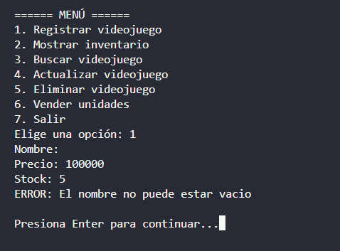 |
- 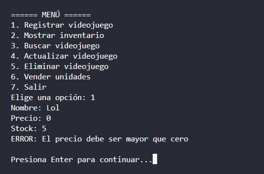 |
- 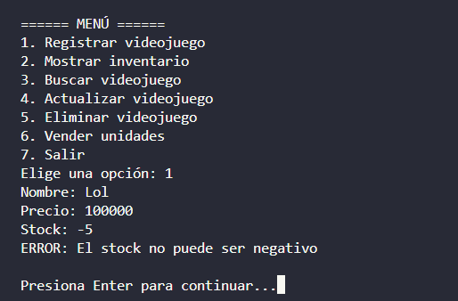 |
- 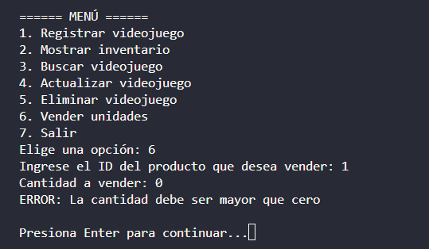 |
- 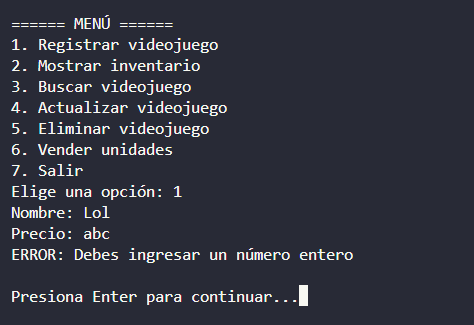 |
- 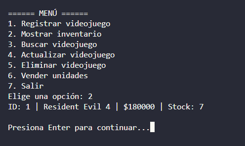 |

## Cómo ejecutar

Clona el repositorio y entra a la carpeta del proyecto:

```bash
git clone <URL-del-repositorio>
cd <carpeta-del-repositorio>
```

Requiere Python 3.10 o superior (se usa `match`). SQLite viene incluido en la biblioteca estándar.

Ejecuta:

```bash
python main.py
```

La base de datos `tienda.db` se crea automáticamente en la carpeta desde donde se ejecuta el programa.

El programa funciona en Windows, Linux y macOS: la limpieza de pantalla y la pausa se resuelven según el sistema operativo.

## Pruebas realizadas y evidencias

Datos de prueba: **Resident Evil 4**, precio `180000`, stock `10`.

| # | Prueba | Resultado esperado | Resultado obtenido | Evidencia |
|---|---|---|---|---|
| 1 | Registrar Resident Evil 4 (180000, stock 10) | 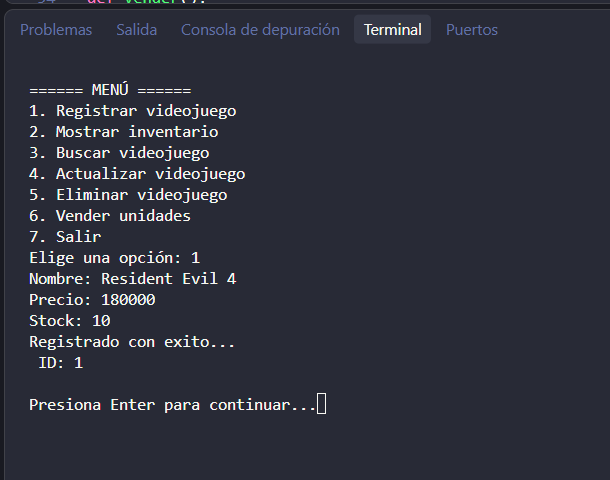 |
| 2 | Mostrar inventario |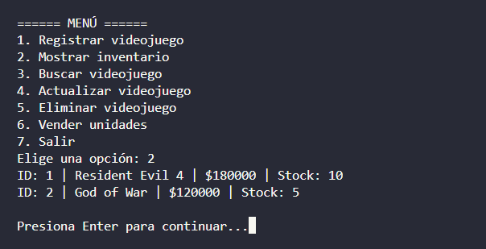 |
| 3 | Buscar un ID existente | 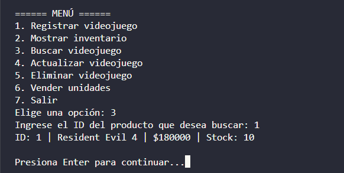 |
| 4 | Actualizar un producto | 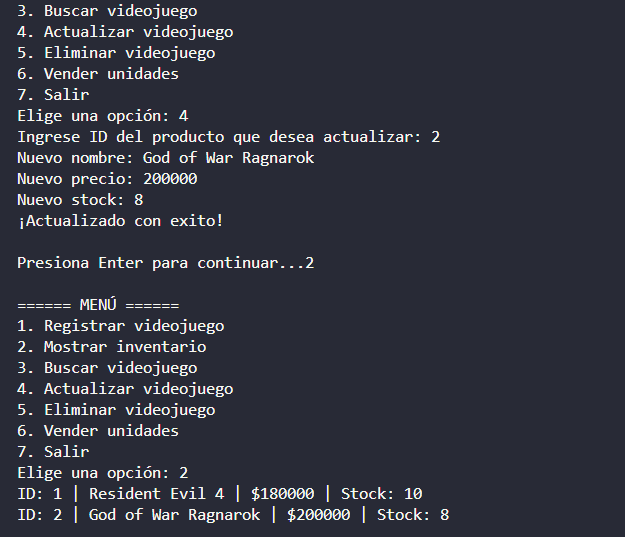 |
| 5 | Vender 3 unidades de Resident Evil 4 | 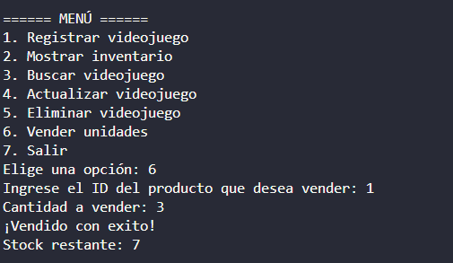 |
| 6 | Intentar vender 20 unidades | 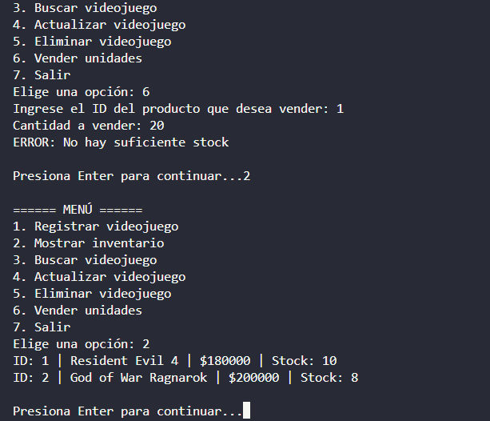 |
| 7 | Buscar un ID inexistente | 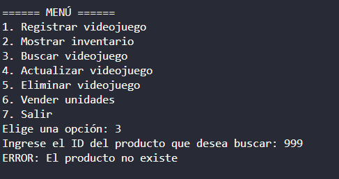 |
| 8 | Eliminar un producto | 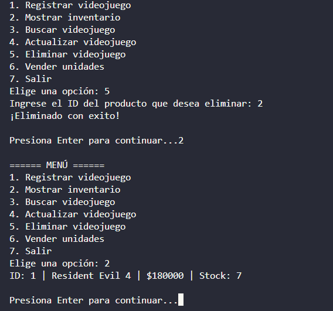 |

---

# Documento original del proyecto base

> Lo que sigue es el README original entregado con el proyecto base. Se conserva como referencia; el estado descrito allí corresponde a la versión inicial.

## Sistema de inventario de videojuegos

Aplicación educativa para organizar una solución de inventario usando Python,
programación orientada a objetos (POO), el patrón DAO y SQLite. El propósito es
separar las responsabilidades del programa; no introducir SQL nuevo.

### Estado actual

Por ahora, la aplicación inicializa la base de datos y registra un videojuego de
ejemplo. El inventario, la búsqueda por ID, la actualización, la eliminación y
la venta de unidades todavía están pendientes de implementar.

Al ejecutar el programa más de una vez se vuelve a registrar el ejemplo
«Resident Evil 4». No se limpia la base de datos automáticamente.

### Cómo funciona

El recorrido actual es:

1. `main.py` llama a `inicializar_bd()` para crear la tabla si todavía no existe.
2. Crea un objeto `ProductoDAO`.
3. Construye un `Producto` de ejemplo y lo envía al DAO para guardarlo.
4. El DAO ejecuta un `INSERT` parametrizado en SQLite, confirma la transacción
   y asigna al objeto el ID generado.
5. `main.py` imprime el ID del producto registrado.

#### Responsabilidad de cada archivo

- `main.py`: punto de entrada; actualmente inicializa la base de datos y registra
  un producto de prueba directamente.
- `modelo.py`: define `Producto`, el objeto que representa un videojuego con
  `id`, `nombre`, `precio` y `stock`.
- `base_datos.py`: abre la conexión SQLite y crea la tabla `productos`.
- `producto_dao.py`: contiene `ProductoDAO`, responsable de persistir un producto.
  DAO significa *Data Access Object*: concentra el acceso a los datos y evita
  mezclar las consultas SQL con el resto de la aplicación.
- `producto_servicio.py`: contiene `ProductoServicio` y las reglas actuales de
  validación para registrar un producto. Este servicio existe, pero `main.py`
  todavía no lo utiliza.

La tabla tiene un ID autoincremental y requiere nombre, precio y stock. La base
se llama `tienda.db` y SQLite la crea en el directorio desde el que se ejecuta
el programa.

### Ejecutar

Requiere Python 3; SQLite forma parte de la biblioteca estándar de Python.

Desde la carpeta del proyecto:

```bash
python3 main.py
```

La salida actual muestra el ID generado, por ejemplo:

```text
Producto registrado con ID: 1
```

El ID exacto puede cambiar según los registros previos de `tienda.db`.

### Funcionalidades previstas

La meta del ejercicio es completar estas operaciones:

| Operación | Estado | Descripción |
|---|---|---|
| Registrar videojuego | Parcial | El DAO puede insertar un producto y el servicio valida nombre, precio y stock. |
| Mostrar inventario | Pendiente | Consultar y mostrar todos los productos guardados. |
| Buscar por ID | Pendiente | Consultar un producto y manejar el caso en que el ID no exista. |
| Actualizar datos | Pendiente | Modificar los datos de un producto existente. |
| Eliminar videojuego | Pendiente | Eliminar un producto existente. |
| Vender unidades | Pendiente | Descontar unidades y rechazar la venta si supera el stock disponible. |

Para respetar la separación de responsabilidades, las consultas y escrituras
SQL corresponden al DAO; las reglas de negocio, al servicio; y la interacción
con la persona usuaria, a `main.py` (o a una interfaz que se agregue después).

### Información necesaria para completar las pruebas

Antes de cerrar los casos de prueba, hace falta acordar los datos y resultados
esperados. Se puede complementar esta sección con:

1. **Datos iniciales de videojuegos**: nombre, precio y stock de cada registro.
   El ID lo asignará SQLite, salvo que se quiera probar expresamente algún caso
   con un ID conocido.
2. **Moneda y formato de precio**: por ejemplo, pesos colombianos como número
   entero. Actualmente el programa guarda `precio` como entero, pero no define
   una moneda.
3. **Caso de venta correcta**: ID del videojuego, cantidad a vender y stock que
   se espera después de la operación.
4. **Caso de venta rechazada**: ID, stock disponible y cantidad solicitada mayor
   que ese stock; indicar el mensaje o resultado esperado.
5. **Casos de IDs inexistentes**: qué debe informar cada operación cuando el
   producto no existe.
6. **Reglas adicionales**: si se permiten nombres repetidos, si se puede
   actualizar el stock directamente y qué comportamiento se espera al eliminar
   un producto.
7. **Repetición de pruebas**: indicar si se probará con una base vacía o con
   datos que permanezcan entre ejecuciones. La aplicación actual conserva los
   datos y vuelve a insertar el videojuego de ejemplo cada vez.

### Tabla de Datos de Prueba y Resultados Esperados

| Caso | Nombre | Precio | Stock inicial | Operación / cantidad | Resultado esperado |
|---|---|---:|---:|---|---|
| 01 | Resident Evil 4 | 180000 | 10 | Registrar producto | Producto guardado correctamente |
| 02 | Resident Evil 4 | 180000 | 10 | Mostrar inventario | Muestra ID, nombre, precio y stock |
| 03 | Resident Evil 4 | 180000 | 10 | Buscar por ID existente | Se muestran los datos del videojuego |
| 04 | Resident Evil 4 | 200000 | 15 | Actualizar datos | Los cambios quedan guardados en SQLite |
| 05 | Resident Evil 4 | 180000 | 10 | Vender 3 unidades | Venta aceptada; stock final pasa de 10 a 7 |
| 06 | Resident Evil 4 | 180000 | 7 | Vender 20 unidades | Operación rechazada; se conserva el stock |
| 07 | N/A | N/A | N/A | Buscar ID inexistente | Se informa que el ID no existe |
| 08 | Resident Evil 4 | 180000 | 7 | Eliminar por ID | El producto deja de aparecer en el inventario |
| 09 | "" (vacío) | 150000 | 5 | Registrar | Rechazado: Nombre no puede estar vacío |
| 10 | Halo Infinite | -50000 | 5 | Registrar | Rechazado: El precio debe ser mayor a 0 |
| 11 | FIFA 23 | 120000 | -10 | Registrar | Rechazado: El stock no puede ser negativo |
| 12 | Resident Evil 4 | 180000 | 10 | Vender 0 o unidades negativas | Rechazado: La cantidad debe ser mayor a 0 |
| 13 | N/A | N/A | N/A | Ingresar texto en número | Muestra "Debes ingresar un número entero" |
| 14 | Resident Evil 4 | 180000 | 7 | Reiniciar aplicación | Los datos se conservan correctamente |

También se necesitan, como mínimo, un caso de venta por encima del stock y un
caso con un ID que no exista, con el mensaje o comportamiento esperado en ambos.